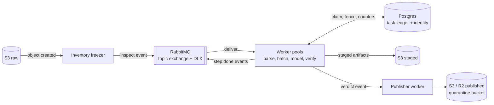
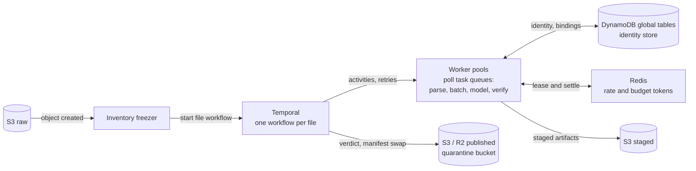

# Part B: running this pipeline over 1 PB

Part A is a single-machine implementation: SQLite ledger, local filesystem, one
coordinator, two workers. Its measured anchors: the 100,000-row CSV publishes
19.18 MB in 120.29 s under two CPUs and 1 GB RAM (0.574 GB/hour per two-worker
pod, zero remote calls, peak memory at the container ceiling, zero OOM kills)
([evidence](benchmarks/bulk-100k-v30.json)), and the full 2 GiB file does not
meet the 30-minute gate: the timed attempt analyzed 1.87M of 11.2M rows in
1,800 s ([evidence](benchmarks/large-csv-2g-v30.json)); at the measured
at-scale rate of about 1,040 analyzed rows/s, completion is projected at
roughly four hours and about 19 GB of state, so the full-coverage run was
stopped and this projection recorded instead of a completed measurement.

This design keeps Part A's content logic (detection, identity resolution,
redaction, independent verification) and its step graph (inspect, analyze,
resolve, rewrite, verify, publish or quarantine). Two execution designs are
given. Design 1 is the straightforward event-driven system to build first;
Design 2 is the production version, using Temporal for durable execution.

## Shared infrastructure

- **Object storage** (both designs): Amazon S3 in the processing region for
  raw, staged and verified bytes (same-region reads have no egress cost,
  object-lock gives WORM originals); **Cloudflare R2 for published output**
  when consumers are multi-region, because zero egress fees dominate wide
  read fan-out. Both speak the S3 API.
- **Identity store**: keyed by tenant, issuer, role and normalized
  identifier, with unique constraints and compare-and-swap revisions.
  Design 1 uses a PostgreSQL schema; Design 2 uses DynamoDB global tables
  for multi-region operation. Surrogates stay HMAC-derived from a protected,
  versioned key, so the store serves entity resolution, not every
  replacement; workers cache immutable bindings.
- **Redis**: token buckets for provider rate limits and dollar reservations;
  completed model responses cache here keyed by input, policy and model
  fingerprint.
- **Workers** (both designs): autoscaled container pools running Part A's
  parsers, policies and verifier unchanged, one pool per worker class
  (parse, analysis, batch, model, verify).
- **Reconciler** (both designs): a scheduled job joining the frozen
  inventory against terminal states, byte-denominated, alerting on stalled
  entries and declaring the run finished.

## Design 1: straightforward event-driven

RabbitMQ (three-node cluster) with one topic exchange; each worker class has
a queue and a dead-letter exchange that keeps the reason and checkpoint
reference with the message. There is no orchestrator: every step's completion
is itself an event, workers publish `step.done`, and each class subscribes to
the events that create its work. PostgreSQL 16 (primary plus replicas,
partitioned by file hash) holds the task ledger: workers claim with
`SELECT ... FOR UPDATE SKIP LOCKED`, the Postgres-native claim Part A's
SQLite queue already mimics. Fencing tokens in the same rows reject commits
from expired attempts, and per-file batch counters fire the next step when
the last batch lands.

Failure handling is queue-native: unacknowledged messages redeliver to
another worker, the fencing token rejects the stale commit, and exhausted
redeliveries dead-letter and quarantine the file. The tradeoff: flow logic
is smeared across subscriptions, so seeing or stopping one file's progress
means querying the ledger, and retries, leases and counters are all
hand-built machinery to own. Right for a single-region, bounded run.

## Design 2: production version with Temporal

The production design replaces the hand-built ledger machinery with
Temporal (Temporal Cloud, or a self-hosted cluster on PostgreSQL): durable
execution gives the leases, retries, fencing and counters as primitives.
One workflow per file (or per pack of small files) owns ordering,
relationships and final assembly: inspect, shard, run batch activities,
resolve, publish or quarantine. Batch activities carry retry policies with
backoff and jitter; long OCR activities send heartbeats; timers enforce
per-file deadlines; signals pause or kill a run; workflow visibility shows
every file's live state without querying anything. Workers poll Temporal
task queues, one queue per worker class, which are the worker
communications: RabbitMQ leaves the critical path, removing a stateful
broker to operate. At hundreds of millions of files, pack small files into
one workflow per pack to control history volume.

Failure handling: an activity that dies is retried on another worker
automatically against the same staged inputs; staged artifacts are
write-once and content-addressed before their workflow commit, so retries
are idempotent; conditional publication accepts one logical result even
when execution repeats; exhausted retries fail the workflow, which
quarantines the file with the reason. The tradeoff: Temporal is a stateful
service to run (or a per-action bill on Cloud) and is not a data store, so
the identity and budget services remain separate. This is the version to
run at petabyte scale with per-file SLAs, multi-region identity and the
ability to stop one file or the whole fleet cleanly.

## 1. Unit of work and parallelism

The unit is one task: a whole file for inspect, analyze, resolve and verify
on ordinary files; a record batch, worksheet partition or rendered page for
large ones. Design 1 fans out through RabbitMQ events; Design 2 fans out
through child workflows and batch activities. Queues scale their own worker
pools against their own limits; the first saturation point is CPU OCR and
pixel verification, the second the hosted-model quota. Part A's measured
0.574 GB/hour per two-worker pod is the planning floor, not a fleet claim:
its single analysis task leaves the second CPU mostly idle, and fanned-out
batch tasks remove that ceiling.

## 2. Shared identity state

An encrypted identity store keyed by tenant, issuer, role and normalized
identifier: PostgreSQL in Design 1, DynamoDB global tables in Design 2, both
with unique constraints and compare-and-swap revisions. Extraction writes
idempotent evidence batches; resolution runs per connected component before
rewrite and freezes a versioned identity snapshot that workers cache.
Conflicting identifiers quarantine the affected component instead of
last-writer-wins; a component merge invalidates dependent work. Name-only
ambiguity stays unresolved. Key rotation or identity-policy changes produce
a new output version.

## 3. Large single files

For a 2 GB CSV, the analysis stage streams once, records complete-record
boundaries, and fans out batch tasks capped by rows and decoded bytes. Batch
workers persist row ranges, hashes and identity evidence to staged objects;
a per-file counter (ledger row or workflow) fires resolve when the last
batch lands. Buffers are bounded independently of file size. This replaces
Part A's measured slow path (per-row encrypted identity state of about
1.7 KB/row and a single analysis task), not an A7 pass.

For a 400,000-cell workbook, stream worksheet XML and externalize shared
strings; inventory formulas, comments, relationships, hidden sheets,
drawings and metadata. Partition cell assessment while retaining
workbook-wide references; rewrite a new archive and verify all parts and
cell counts.

For a 3,000-page scanned PDF, inventory pages and non-page objects, render
one page at bounded resolution, and checkpoint OCR, masks and independent
verification per page (heartbeat while a long page runs). Limit concurrent
decoded pixels, not just compressed bytes. Reserve per-file CPU, page and
model budgets before dispatch; exhaustion quarantines the parent, and no
prefix is published. None of these designs permits truncation to meet a
deadline.

## 4. Cost assumptions and estimate

Planning assumptions, not market quotes. Decimal 1 PB = 1,000 TB. Assume 80%
structured/text bytes and 20% scanned bytes at 0.5 MB/page (400,000
pages/TB); a two-worker pod at $0.10/hour; text processing at the measured
0.574 GB/hour; two worker-seconds per scanned page for render, OCR and pixel
checks.

| Component | Assumption per input TB | Cost/TB |
| --- | --- | ---: |
| Text processing | 800 GB / 0.574 GB/hour | $139.37 |
| Scan processing | 400,000 pages × 2 seconds | $22.22 |
| Storage | Three TB copies retained three months, $10/TB-month, mostly R2 | $90.00 |
| Data plane: queues, ledger or workflow actions | Provisional allowance | $8.00 |
| Selective remote inference | Calculation below | $40.08 |
| Total with 20% contingency | Compute, storage and inference | **$359.60** |

The 1 PB estimate is **$359,600**, excluding human review; local-only planning
is about **$312/TB ($312,000/PB)**. The text rate is the measured v30 subset
rate; the scan rate is assumed, not measured. For the model allowance: four
bytes/token, 1,000 OCR tokens/page, 1,000-token chunks, remote selection of
0.1% of chunks: 200,400 requests/TB at 1,000 input and 100 output tokens, at
$0.15/$0.50 per million tokens, gives $40.08/TB. Tenfold selection
multiplies that line tenfold. Benchmark real mixtures before procurement.

## 5. Fleet limits and hard budgets

Before a model worker calls the endpoint it leases request tokens, output
tokens and dollars from the Redis token service against run and file
ceilings; completed receipts settle the lease and uncertain responses retain
it. No worker owns an independent spend allowance. Retries apply backoff
with jitter in both designs (queue redelivery or activity retry policy);
exhausted budgets fall back to verified local handling or quarantine.
Adding workers past quota grows waiting time, not throughput: at 1,000
requests/minute the assumed 200.4 million calls for 1 PB need at least 139
days before retries, so selective inference needs explicit scheduling and
deadlines.

## 6. Failure, recovery and backpressure

A worker dying mid-task changes nothing durable in either design: Design 1
redelivers the unacknowledged message and rejects the stale commit with the
fencing token; Design 2 retries the activity automatically against the same
staged inputs. Artifacts are written once and content-addressed before
their commit, so recovery is idempotent, and conditional publication accepts
one logical result even when execution repeats. Exhausted retries dead-letter
(Design 1) or fail the workflow (Design 2) and quarantine the parent with
the reason. Backpressure stops upstream dispatch when staged bytes, queue
age, memory pressure or budget reservations exceed limits. Model billing
cannot be exactly once without provider support; the reservation ledger
bounds the exposure, as in Part A. Recovery never accumulates unbounded
intermediate data.

## 7. Completeness and correctness

Freeze an inventory of object version, size and content hash at ingest. The
reconciler joins every parent and expected record, cell, page and embedded
surface to a terminal published or quarantined state; the run finishes only
when all inventory entries are terminal and no leases or unaccounted
artifacts remain. Verdicts bind to input/output hashes, identity snapshot,
policy and model versions. Independent scans, exact clinical comparisons,
adversarial tests and stratified fresh labels provide evidence; they cannot
prove universal absence of PHI. Missing coverage blocks publication, exactly
as in Part A.

## 8. Locality and immutable storage

Workers run in the data's region and residency boundary, over private
networking with scoped object access and managed keys. Originals are never
modified; staged and published bytes are content-addressed, versioned and
immutable (S3 object-lock). Publishing swaps a conditional manifest pointing
at verified immutable objects. Quarantine gets separate access and retention
policies. R2 publication saves egress wherever reviewers or consumers read
from multiple regions; cross-region transfer of raw bytes is an explicit
policy and cost decision, not a default.

## 9. Observability

Track input bytes reconciled, verified bytes published, records/cells/pages
covered, OCR pixels, clinical-change failures, quarantine bytes by reason,
queue age and depth, redelivery or retry rates, lease expiries, worker
memory, temporary staging growth, identity conflicts, model tokens,
reservations and settled spend. Design 2 adds workflow-level visibility
(running, failed, timed-out) for free. Alert on stalled byte or page
progress, coverage gaps, elevated rejection rates and projected budget or
deadline breaches. File counts alone hide large incomplete objects, so every
progress metric is byte- or record-denominated. Logs carry hashes and reason
codes, never PHI.

## 10. Unsupported long tail

Thousands of formats, encodings and corrupt files: an explicit capability
registry per format family, with a quarantine path that preserves the
original, records the precise reason, and never blocks the fleet. Unknown
types route to a characterization queue (bounded sample, then decide); no
silent skips. The registry is versioned with the policy so reruns are
reproducible.

## Where Part A falls short of both designs

Part A demonstrates the content contracts (detection, policies, independent
verification, fail-closed quarantine, reconciliation accounting) on one
machine with crash recovery, and its A7 evidence is measured honestly. Its
SQLite ledger, fenced attempts and coordinator wiring are the single-node
version of both designs' machinery. It does not demonstrate the distributed
substrate itself: no object storage, no queues, no shared identity store, no
Temporal, no Redis rate leasing, and its large-file path is measured as too
slow for the 30-minute gate with the causes identified (per-row encrypted
state and single-task analysis).
