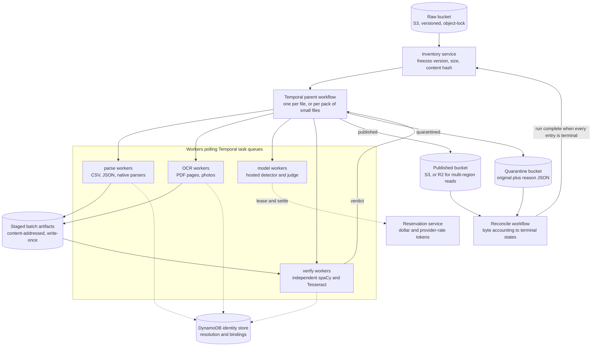

# Part B: running this pipeline over 1 PB

Part A is a single-machine implementation: SQLite ledger, local filesystem, one
coordinator, two workers. Its measured anchors: the 100,000-row CSV publishes
19.18 MB in 120.29 s under two CPUs and 1 GB RAM (0.574 GB/hour per two-worker
pod, zero remote calls, peak memory at the container ceiling, zero OOM kills)
([evidence](benchmarks/bulk-100k-v30.json)), and the full 2 GiB file does not
meet the 30-minute gate: the timed attempt analyzed 1.87M of 11.2M rows in
1,800 s ([evidence](benchmarks/large-csv-2g-v30.json)); at the measured
at-scale rate of about 1,040 analyzed rows/s, completion is projected at
roughly four hours and about 19 GB of state, so the full-coverage run was
stopped and this projection recorded instead of a completed measurement.

This design keeps Part A's content-processing logic (detection, identity
resolution, redaction, independent verification) and replaces its execution
substrate. The healthcare policies and verifier semantics are unchanged.

## System shape

Chosen infrastructure, with reasons:

- **Object storage**: S3 in the processing region for raw, staged and verified
  bytes (same-region reads have no egress cost, object-lock gives WORM
  originals). **Cloudflare R2 for published output** when downstream consumers
  are multi-region: zero egress fees dominate the storage line at read-heavy
  fan-out. Both speak the S3 API, so the pipeline stays storage-agnostic.
- **Orchestration: Temporal**. One workflow per file: inspect, shard, dispatch
  batch activities, track batch manifests, publish or quarantine, with
  per-activity retry policies, heartbeats for long OCR, timers for deadlines
  and signals to pause or kill a run. Durable execution replaces Part A's
  custom checkpoint machinery (SQLite ledger, fenced attempts, run locks) with
  primitives. Workers poll **Temporal task queues**, which are the worker
  communications: no separate broker for orchestration, and separate queues
  per worker class (parse, OCR, model, verify) scale independently.
  Tradeoff: Temporal is not a data store, adds a stateful service to operate,
  and at hundreds of millions of files the fix is packing (one workflow per
  N small files, not one per file). The alternative, SQS plus a hand-built
  state table with retries and fencing, is exactly the machinery Part A
  already carries; Temporal buys it managed.
- **Shared state: DynamoDB global tables** (or Postgres/CockroachDB where a
  relational ledger is preferred). Surrogates stay HMAC-derived from a
  protected, versioned key, so the shared store serves entity resolution and
  binding, not every replacement: workers cache immutable bindings and batch
  their lookups, which keeps central traffic proportional to distinct
  entities, not to records.

## 1. Unit of work and parallelism

A Temporal workflow per file (or per pack of small files) owns ordering,
relationships and final assembly. Large files shard into batch activities:
record batches for CSV/JSON streams (both row- and byte-capped, split only at
complete-record boundaries), worksheet partitions, single pages for scans.
The first saturation point is CPU OCR and pixel verification for scanned
bytes; the second is the hosted-model quota. Measure both before adding
workers; separate task queues let each pool scale against its own limit.
Part A's measured rate (0.574 GB/hour per two-worker pod on structured text)
is the planning floor, not a fleet claim: its single analysis task leaves the
second CPU mostly idle, and sharded batch execution removes that ceiling.

## 2. Shared identity state

An encrypted relational identity store keyed by tenant, issuer, role and
normalized identifier, in DynamoDB with unique constraints and
compare-and-swap revisions. Extraction writes idempotent evidence batches;
resolution runs per connected component before rewrite and freezes a
versioned identity snapshot that workers cache. Conflicting identifiers
quarantine the affected component instead of last-writer-wins; a component
merge invalidates dependent work. Name-only ambiguity stays unresolved.
Key rotation or identity-policy changes produce a new output version.
Concurrency on the hot path is bounded because surrogate derivation is keyed
and local; the store is consulted for resolution, not for each replacement.

## 3. Large single files

For a 2 GB CSV, build complete-record boundary checkpoints while streaming,
then process shards as batch activities capped by rows and decoded bytes.
Persist row ranges, hashes and identity evidence; assemble verified batches
in order and reconcile every row. Bound buffers independently of file size.
This replaces Part A's measured slow path (per-row encrypted identity state
of about 1.7 KB/row and a single analysis task), not an A7 pass.

For a 400,000-cell workbook, stream worksheet XML and externalize shared
strings; inventory formulas, comments, relationships, hidden sheets, drawings
and metadata. Partition cell assessment while retaining workbook-wide
references; rewrite a new archive and verify all parts and cell counts.

For a 3,000-page scanned PDF, inventory pages and non-page objects, render
one page at bounded resolution, and checkpoint OCR, masks and independent
verification per page with activity heartbeats. Limit concurrent decoded
pixels, not just compressed bytes. Reserve per-file CPU, page and model
budgets before dispatch; exhaustion pauses or quarantines the parent, and no
prefix is published. None of these designs permits truncation to meet a
deadline.

## 4. Cost assumptions and estimate

Planning assumptions, not market quotes. Decimal 1 PB = 1,000 TB. Assume 80%
structured/text bytes and 20% scanned bytes at 0.5 MB/page (400,000 pages/TB);
a two-worker pod at $0.10/hour; text processing at the measured 0.574 GB/hour;
two worker-seconds per scanned page for render, OCR and pixel checks.

| Component | Assumption per input TB | Cost/TB |
| --- | --- | ---: |
| Text processing | 800 GB / 0.574 GB/hour | $139.37 |
| Scan processing | 400,000 pages × 2 seconds | $22.22 |
| Storage | Three TB copies retained three months, $10/TB-month, mostly R2 | $90.00 |
| Queues, workflow and ledger operations | Provisional allowance | $8.00 |
| Selective remote inference | Calculation below | $40.08 |
| Total with 20% contingency | Compute, storage and inference | **$359.60** |

The 1 PB estimate is **$359,600**, excluding human review; local-only planning
is about **$312/TB ($312,000/PB)**. The text rate is the measured v30 subset
rate, 2.4x the previous committed run; the scan rate is assumed, not measured.
For the model allowance: four bytes/token, 1,000 OCR tokens/page, 1,000-token
chunks, remote selection of 0.1% of chunks: 200,400 requests/TB at 1,000 input
and 100 output tokens, at $0.15/$0.50 per million tokens, gives $40.08/TB.
Tenfold selection multiplies that line tenfold. Benchmark real mixtures
before procurement.

## 5. Fleet limits and hard budgets

A central reservation service (DynamoDB conditional writes, the distributed
form of Part A's ledger) reserves request tokens, output tokens, requests and
dollars against run and file ceilings before any model activity is dispatched.
Shared token buckets lease per-worker slots against provider limits; completed
receipts settle reservations and uncertain responses retain them. No worker
owns an independent spend allowance. Completed responses cache by input,
policy and model fingerprint. Temporal activity retries apply backoff with
jitter; exhausted budgets fall back to verified local handling or quarantine.
Adding workers past quota grows waiting time, not throughput: at 1,000
requests/minute the assumed 200.4 million calls for 1 PB need at least 139
days before retries, so selective inference needs explicit scheduling and
deadlines.

## 6. Failure, recovery and backpressure

A worker dying mid-activity loses nothing durable: Temporal retries the
activity on another worker against the same staged inputs, and write-once
artifacts before committing checkpoints. Attempt fencing rejects stale
completions; conditional publication accepts one logical result even when
execution repeats. Batch activities that exhaust retries dead-letter with
reason and checkpoint references and quarantine the parent file. Backpressure
stops upstream dispatch when staged bytes, queue age, memory pressure or
budget reservations exceed limits. Model billing cannot be exactly once
without provider support; the reservation ledger bounds the exposure, as in
Part A. Recovery never accumulates unbounded intermediate data.

## 7. Completeness and correctness

Freeze an inventory of object version, size and content hash at ingest.
A reconciliation workflow joins every parent and expected record, cell, page
and embedded surface to a terminal published or quarantined state; the run
finishes only when all inventory entries are terminal and no leases or
unaccounted artifacts remain. Verdicts bind to input/output hashes, identity
snapshot, policy and model versions. Independent scans, exact clinical
comparisons, adversarial tests and stratified fresh labels provide evidence;
they cannot prove universal absence of PHI. Missing coverage blocks
publication, exactly as in Part A.

## 8. Locality and immutable storage

Workers run in the data's region and residency boundary, polling task queues
over private networking with scoped object access and managed keys. Originals
are never modified; staged and published bytes are content-addressed,
versioned and immutable (S3 object-lock). Publishing swaps a conditional
manifest pointing at verified immutable objects. Quarantine gets separate
access and retention policies. R2 publication saves egress wherever reviewers
or consumers read from multiple regions; cross-region transfer of raw bytes
is an explicit policy and cost decision, not a default.

## 9. Observability

Track input bytes reconciled, verified bytes published, records/cells/pages
covered, OCR pixels, clinical-change failures, quarantine bytes by reason,
queue age, activity retry rates, checkpoint lag, worker memory, temporary
staging growth, identity conflicts, model tokens, reservations and settled
spend. Alert on stalled byte or page progress, coverage gaps, elevated
rejection rates and projected budget or deadline breaches. File counts alone
hide large incomplete objects, so every progress metric is byte- or
record-denominated. Temporal adds workflow-level visibility (running, failed,
timed-out) on the same dashboard. Logs carry hashes and reason codes, never
PHI.

## 10. Unsupported long tail

Thousands of formats, encodings and corrupt files: an explicit capability
registry per format family, with a quarantine path that preserves the
original, records the precise reason, and never blocks the fleet. Unknown
types route to a characterization queue (bounded sample, then decide); no
silent skips. The registry is versioned with the policy so reruns are
reproducible.

## Where Part A falls short of this design

Part A demonstrates the content contracts (detection, policies, independent
verification, fail-closed quarantine, reconciliation accounting) on one
machine with crash recovery, and its A7 evidence is measured honestly. It
does not demonstrate any of this design's distributed substrate: no object
storage, no Temporal (its SQLite ledger, run lock and checkpoint machinery
are the single-node version), no shared identity store beyond one database,
no fleet-wide rate leasing, and its large-file path is measured as too slow
for the 30-minute gate with the causes identified (per-row encrypted state
and single-task analysis).
