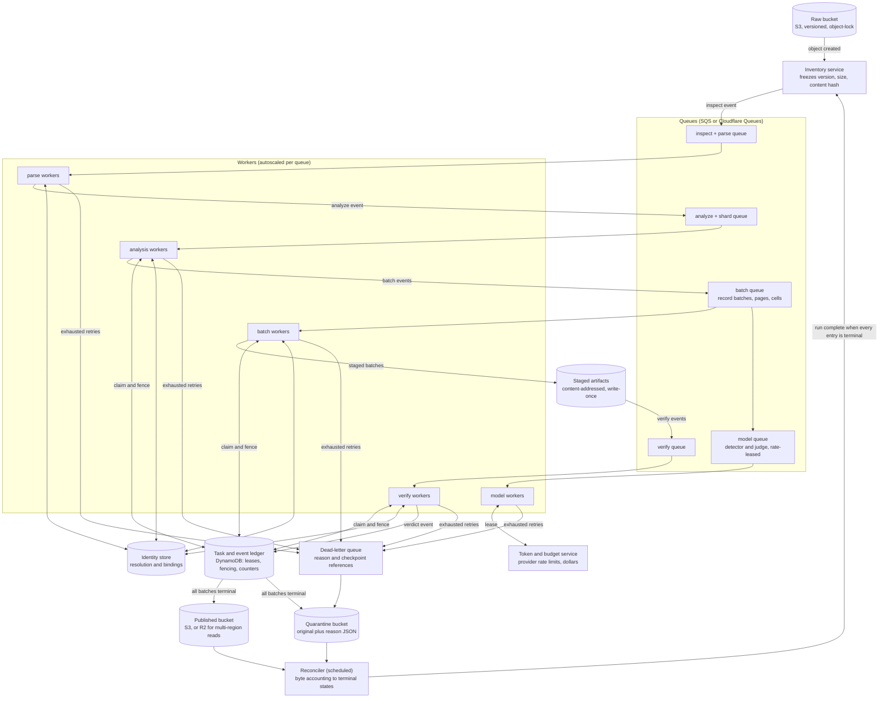

# Part B: running this pipeline over 1 PB

Part A is a single-machine implementation: SQLite ledger, local filesystem, one
coordinator, two workers. Its measured anchors: the 100,000-row CSV publishes
19.18 MB in 120.29 s under two CPUs and 1 GB RAM (0.574 GB/hour per two-worker
pod, zero remote calls, peak memory at the container ceiling, zero OOM kills)
([evidence](benchmarks/bulk-100k-v30.json)), and the full 2 GiB file does not
meet the 30-minute gate: the timed attempt analyzed 1.87M of 11.2M rows in
1,800 s ([evidence](benchmarks/large-csv-2g-v30.json)); at the measured
at-scale rate of about 1,040 analyzed rows/s, completion is projected at
roughly four hours and about 19 GB of state, so the full-coverage run was
stopped and this projection recorded instead of a completed measurement.

This design keeps Part A's content logic (detection, identity resolution,
redaction, independent verification) and replaces its execution substrate with
a straightforward event-driven system. Part A's step graph (inspect, analyze,
resolve, rewrite, verify, publish or quarantine) is unchanged; each step
transition becomes a queue event instead of a SQLite successor row.

## System shape

Components, with reasons:

- **Object storage**: S3 in the processing region for raw, staged and verified
  bytes (same-region reads have no egress cost, object-lock gives WORM
  originals). **Cloudflare R2 for published output** when downstream consumers
  are multi-region: zero egress fees dominate when read fan-out is wide. Both
  speak the S3 API, so the pipeline stays storage-agnostic.
- **Queues**: one per worker class. A queue event is a claim to do one unit of
  work; visibility timeouts handle crashed workers by redelivery. Each queue
  has a dead-letter queue that preserves the reason and checkpoint reference.
- **Task and event ledger**: a DynamoDB table (or Postgres) holding task
  state, leases and per-shard completion counters. Workers claim with a
  conditional write that carries a fencing token, the distributed form of
  Part A's fenced attempts: a stale worker cannot commit its result.
- **Identity store**: separate table, keyed by tenant, issuer, role and
  normalized identifier. Surrogates stay HMAC-derived from a protected,
  versioned key, so the store serves entity resolution, not every
  replacement; workers cache immutable bindings.
- **Reconciler**: a scheduled job joining the frozen inventory against
  terminal task states, byte-denominated. It alerts on stalled entries and
  declares the run finished.

## 1. Unit of work and parallelism

The unit is one queue event: a file for inspect, analyze, resolve and verify
on ordinary files; a record batch, worksheet partition or rendered page for
large ones. Completion of a step emits the next event, so there is no
central scheduler: the step chain is the event chain, and each queue scales
its own worker pool against its own limit. The first saturation point is CPU
OCR and pixel verification for scanned bytes; the second is the hosted-model
quota. Part A's measured 0.574 GB/hour per two-worker pod is the planning
floor, not a fleet claim: its single analysis task leaves the second CPU
mostly idle, and sharded batch events remove that ceiling.

## 2. Shared identity state

An encrypted relational identity store keyed by tenant, issuer, role and
normalized identifier, in DynamoDB with unique constraints and
compare-and-swap revisions. Extraction writes idempotent evidence batches;
resolution runs per connected component before rewrite and freezes a
versioned identity snapshot that workers cache. Conflicting identifiers
quarantine the affected component instead of last-writer-wins; a component
merge invalidates dependent work. Name-only ambiguity stays unresolved. Key
rotation or identity-policy changes produce a new output version. Hot-path
concurrency stays bounded because surrogate derivation is keyed and local.

## 3. Large single files

For a 2 GB CSV, the analysis worker streams once, records complete-record
boundaries, and emits batch events capped by rows and decoded bytes. Batch
workers persist row ranges, hashes and identity evidence to staged objects;
a per-file counter in the ledger fires the resolve event when the last batch
lands. Buffers are bounded independently of file size. This replaces Part
A's measured slow path (per-row encrypted identity state of about 1.7 KB/row
and a single analysis task), not an A7 pass.

For a 400,000-cell workbook, stream worksheet XML and externalize shared
strings; inventory formulas, comments, relationships, hidden sheets,
drawings and metadata. Partition cell assessment while retaining
workbook-wide references; rewrite a new archive and verify all parts and
cell counts.

For a 3,000-page scanned PDF, inventory pages and non-page objects, render
one page at bounded resolution, and checkpoint OCR, masks and independent
verification per page. Workers renew their lease while a long page runs;
expired leases redeliver. Limit concurrent decoded pixels, not just
compressed bytes. Reserve per-file CPU, page and model budgets before
dispatch; exhaustion quarantines the parent, and no prefix is published.
None of these designs permits truncation to meet a deadline.

## 4. Cost assumptions and estimate

Planning assumptions, not market quotes. Decimal 1 PB = 1,000 TB. Assume 80%
structured/text bytes and 20% scanned bytes at 0.5 MB/page (400,000
pages/TB); a two-worker pod at $0.10/hour; text processing at the measured
0.574 GB/hour; two worker-seconds per scanned page for render, OCR and pixel
checks.

| Component | Assumption per input TB | Cost/TB |
| --- | --- | ---: |
| Text processing | 800 GB / 0.574 GB/hour | $139.37 |
| Scan processing | 400,000 pages × 2 seconds | $22.22 |
| Storage | Three TB copies retained three months, $10/TB-month, mostly R2 | $90.00 |
| Queue, ledger and token operations | Provisional allowance | $8.00 |
| Selective remote inference | Calculation below | $40.08 |
| Total with 20% contingency | Compute, storage and inference | **$359.60** |

The 1 PB estimate is **$359,600**, excluding human review; local-only planning
is about **$312/TB ($312,000/PB)**. The text rate is the measured v30 subset
rate; the scan rate is assumed, not measured. For the model allowance: four
bytes/token, 1,000 OCR tokens/page, 1,000-token chunks, remote selection of
0.1% of chunks: 200,400 requests/TB at 1,000 input and 100 output tokens, at
$0.15/$0.50 per million tokens, gives $40.08/TB. Tenfold selection
multiplies that line tenfold. Benchmark real mixtures before procurement.

## 5. Fleet limits and hard budgets

The token and budget service is a DynamoDB-backed reservation store: before a
model worker calls the endpoint it leases request tokens, output tokens and
dollars against run and file ceilings with a conditional write; completed
receipts settle the lease and uncertain responses retain it. No worker owns
an independent spend allowance. Completed responses cache by input, policy
and model fingerprint. Retries apply backoff with jitter; exhausted budgets
fall back to verified local handling or quarantine. Adding workers past
quota grows waiting time, not throughput: at 1,000 requests/minute the
assumed 200.4 million calls for 1 PB need at least 139 days before retries,
so selective inference needs explicit scheduling and deadlines.

## 6. Failure, recovery and backpressure

A worker dying mid-event changes nothing durable: the lease expires, the
queue redelivers, and another worker resumes from the last staged batch.
Artifacts are written once and content-addressed before their ledger commit,
so redelivery is idempotent; fencing tokens reject completions from stale
attempts, and conditional publication accepts one logical result even when
execution repeats. Events that exhaust their redelivery count land in the
dead-letter queue with the reason and checkpoint reference, and quarantine
the parent file. Backpressure stops upstream dispatch when staged bytes,
queue age, memory pressure or budget reservations exceed limits. Model
billing cannot be exactly once without provider support; the reservation
ledger bounds the exposure, as in Part A. Recovery never accumulates
unbounded intermediate data.

## 7. Completeness and correctness

Freeze an inventory of object version, size and content hash at ingest. The
reconciler joins every parent and expected record, cell, page and embedded
surface to a terminal published or quarantined state; the run finishes only
when all inventory entries are terminal and no leases or unaccounted
artifacts remain. Verdicts bind to input/output hashes, identity snapshot,
policy and model versions. Independent scans, exact clinical comparisons,
adversarial tests and stratified fresh labels provide evidence; they cannot
prove universal absence of PHI. Missing coverage blocks publication, exactly
as in Part A.

## 8. Locality and immutable storage

Workers run in the data's region and residency boundary, over private
networking with scoped object access and managed keys. Originals are never
modified; staged and published bytes are content-addressed, versioned and
immutable (S3 object-lock). Publishing swaps a conditional manifest pointing
at verified immutable objects. Quarantine gets separate access and retention
policies. R2 publication saves egress wherever reviewers or consumers read
from multiple regions; cross-region transfer of raw bytes is an explicit
policy and cost decision, not a default.

## 9. Observability

Track input bytes reconciled, verified bytes published, records/cells/pages
covered, OCR pixels, clinical-change failures, quarantine bytes by reason,
queue age and depth, redelivery rates, lease expiries, worker memory,
temporary staging growth, identity conflicts, model tokens, reservations and
settled spend. Alert on stalled byte or page progress, coverage gaps,
elevated rejection rates and projected budget or deadline breaches. File
counts alone hide large incomplete objects, so every progress metric is
byte- or record-denominated. Logs carry hashes and reason codes, never PHI.

## 10. Unsupported long tail

Thousands of formats, encodings and corrupt files: an explicit capability
registry per format family, with a quarantine path that preserves the
original, records the precise reason, and never blocks the fleet. Unknown
types route to a characterization queue (bounded sample, then decide); no
silent skips. The registry is versioned with the policy so reruns are
reproducible.

## Where Part A falls short of this design

Part A demonstrates the content contracts (detection, policies, independent
verification, fail-closed quarantine, reconciliation accounting) on one
machine with crash recovery, and its A7 evidence is measured honestly. Its
SQLite ledger, fenced attempts and successor wiring are the single-node
version of this design's task ledger, leases and event chain. It does not
demonstrate the distributed substrate itself: no object storage, no queues,
no shared identity store, no fleet-wide rate leasing, and its large-file
path is measured as too slow for the 30-minute gate with the causes
identified (per-row encrypted state and single-task analysis).
